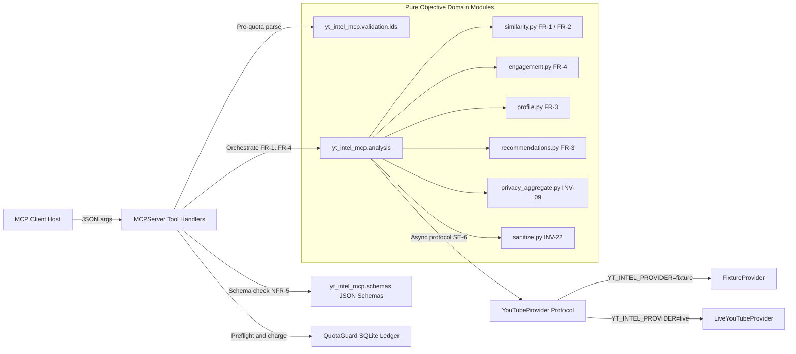
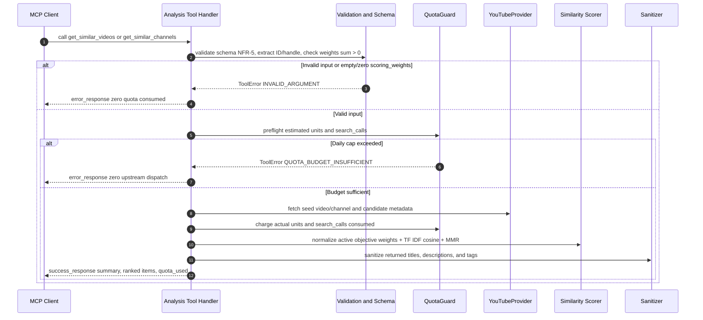
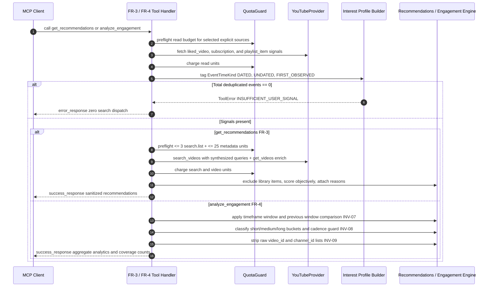

# Analysis Subsystem Architecture and Data Flows (`FR-1`..`FR-4`)

- **Task:** `TS-04` (`SE-2`)
- **Owner:** Molleti Tatwik Sai
- **Requirements:** `FR-1.1`..`FR-1.4`, `FR-2.1`..`FR-2.2`, `FR-3.1`..`FR-3.3`, `FR-4.1`..`FR-4.3`, `NFR-1`, `NFR-5`, `NFR-7`, `NFR-9`, `SE-2`, `SE-6`
- **Related ADRs:**
  - `docs/adr/0002-provider-and-errors.md` (`YouTubeProvider` and `QuotaGuard` boundary)
  - `docs/adr/0003-similarity-scoring.md` (objective TF IDF scoring, redistribution, diversity)
  - `docs/adr/0007-interest-profile.md` (half life decay, `G-05`/`G-06`, cadence and privacy guards)

## Architectural Boundaries

All four analysis tools (`get_video_details`, `get_similar_videos`, `get_similar_channels`, `get_recommendations`, `analyze_engagement`) share strict boundary invariants:

1. **Strict Input Validation Before Quota (`INV-02`, `NFR-5`):** Every MCP call validates JSON arguments against strict `additionalProperties: false` schemas in `src/yt_intel_mcp/schemas/` and parses video/channel IDs locally via `yt_intel_mcp.validation` before calling `QuotaGuard.preflight` or dispatching any provider call.
2. **Provider Isolation (`SE-6`, `INV-19`):** Domain modules (`validation`, `analysis`, `sanitize`) accept and return frozen dataclasses (`VideoMeta`, `ChannelMeta`, `UserEvent`) and invoke only async methods on `YouTubeProvider`. HTTP clients never enter analysis modules.
3. **Objective Metadata Only (`INV-01`):** `VideoMeta`, `ChannelMeta`, JSON Schemas, similarity scorers, and MCP response envelopes exclude `viewCount`, `likeCount`, `subscriberCount`, and `statistics`.
4. **Metadata Sanitization (`INV-22`, `NFR-6`):** Untrusted video titles, tags, and descriptions pass through `yt_intel_mcp.sanitize` before exposure or prompt formatting.

## Component Structure (`SE-2`)

## Video, Channel, and Interest Flow (`FR-1`..`FR-4`)

### 1. Video Details and Similarity Flow (`FR-1`, `FR-2`)

### 2. Personalized Recommendations and Engagement Analytics Flow (`FR-3`, `FR-4`)

## Module Responsibilities Summary

| Module | Owner Task | Primary Responsibility | Strict Boundary Invariants |
|---|---|---|---|
| `src/yt_intel_mcp/schemas/` | `TS-04` | Strict draft 2020-12 JSON Schemas with `additionalProperties: false` | `NFR-5`, `INV-01` |
| `src/yt_intel_mcp/validation/ids.py` | `TS-06` | Extract video IDs, channel IDs/handles, and playlist IDs locally | `INV-02`, zero provider calls |
| `src/yt_intel_mcp/analysis/similarity.py` | `TS-08` | Sublinear TF IDF, duration closeness, redistribution, MMR diversity | `INV-01`, `NFR-1` (`<= 150 ms`) |
| `src/yt_intel_mcp/analysis/engagement.py` | `TS-07`, `TS-14` | Duration buckets, zero division comparison guard, cadence guard, aggregates | `INV-07`, `INV-08`, `INV-09` |
| `src/yt_intel_mcp/analysis/profile.py` | `TS-12` | Deduplicate explicit signals, decay dated events, `0.5` undated weight | `INV-04`, `INV-05`, `INV-06` |
| `src/yt_intel_mcp/analysis/tools.py` | `TS-10`..`TS-14` | Orchestrate preflight, provider reads, scoring, sanitization, envelopes | `INV-02`, `INV-19`, `INV-22` |
