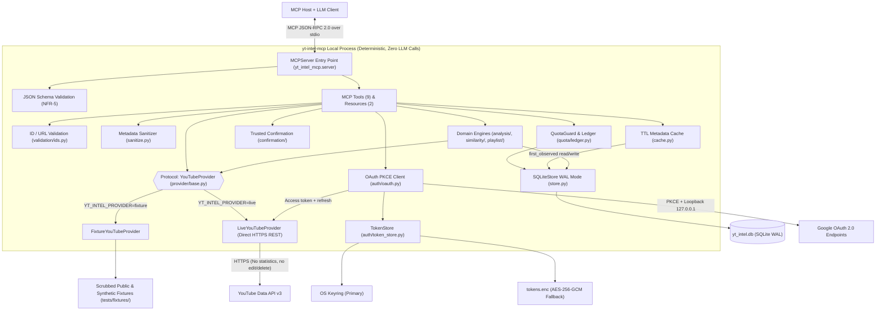
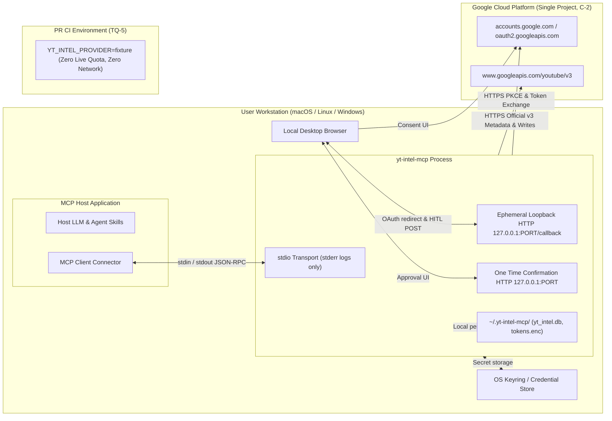
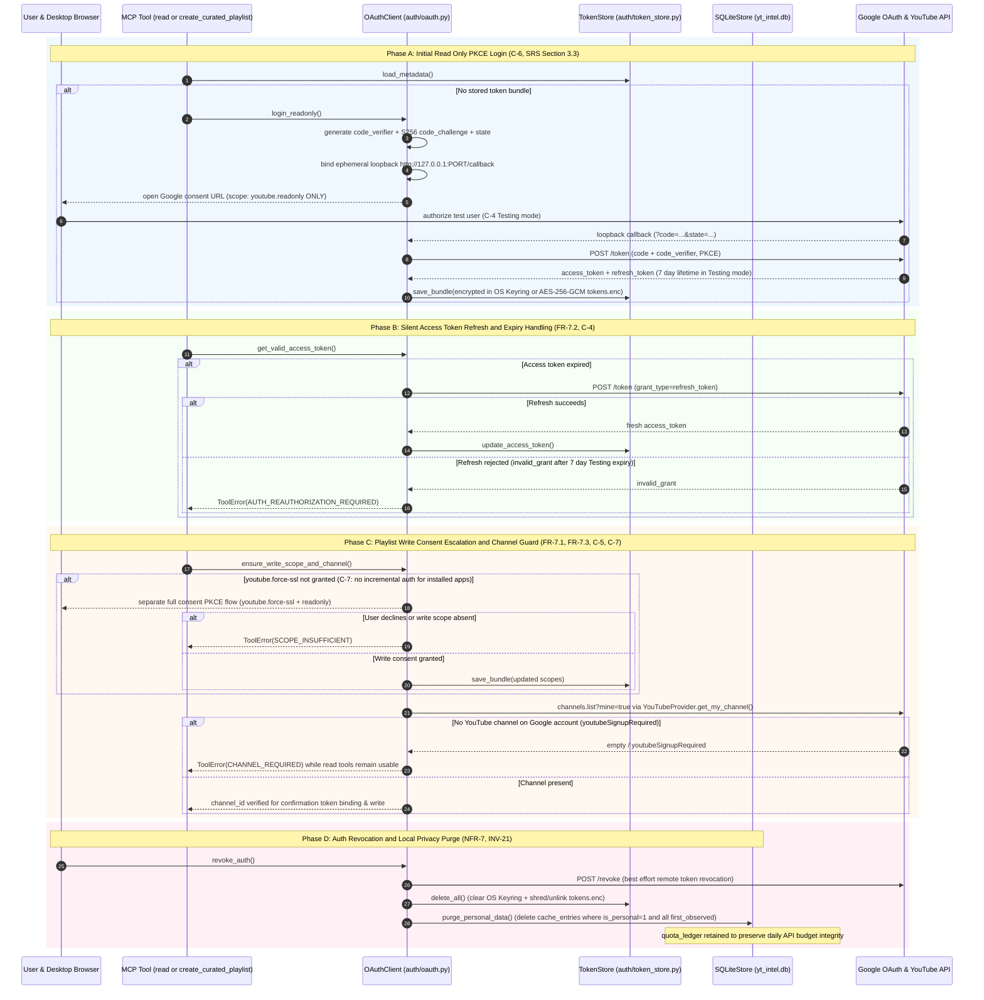

# System Architecture Overview, SQLite Schema, and Runtime Flows (`SE-2`)

- **Task:** `SR-05` (`SE-2`)
- **Owner:** Madire Shiva Reddy (`@Shiva0025`)
- **Reviewer:** Molleti Tatwik Sai (`@tatwiksai080207`)
- **GitHub Issue:** `#30`
- **GitHub PR:** `#31`
- **Requirements:** `SE-2`, `FR-6`, `FR-7`, `NFR-3`, `NFR-7`, `FR-8.1`, `NFR-8`, `NFR-10`, `C-1`..`C-7`
- **Related ADRs:**
  - `docs/adr/0001-runtime-and-toolchain.md` (Python 3.11+, official `mcp` SDK, `src/yt_intel_mcp/schemas/`)
  - `docs/adr/0002-provider-and-errors.md` (`YouTubeProvider` protocol, `QuotaGuard`, 17 frozen `ErrorCode`s)
  - `docs/adr/0006-token-storage-and-persistence.md` (OS keyring, AES-256-GCM fallback, WAL SQLite, delete on revoke)
  - `docs/adr/0003-similarity-scoring.md` and `docs/adr/0007-interest-profile.md` (objective analysis design)
- **Subsystem Architecture:** `docs/architecture/analysis.md` (`FR-1`..`FR-4`)

## 1. Architectural Principles and Trust Boundaries

`yt-intel-mcp` runs locally on the user machine as a deterministic MCP server communicating over `stdio` (`SRS Section 2.1`, `Section 3.3`). Four hard boundaries govern the entire runtime:

1. **Provider Isolation (`SE-6`, `FR-8.1`, `INV-18`):** All YouTube Data API v3 calls traverse `YouTubeProvider` (`src/yt_intel_mcp/provider/base.py`). Only `provider/live.py` and `auth/oauth.py` may dispatch outbound HTTPS calls to official Google endpoints. Domain, similarity, playlist solver, and tool modules never import HTTP or Google client libraries.
2. **Dual Budget Quota Enforcement (`FR-6.1`, `FR-6.2`, `C-2`, `INV-19`):** Both daily budgets (`10,000` units/day and `100` `search.list` calls/day, configurable in `QuotaConfig`, resetting at `00:00` `America/Los_Angeles`) live in a persistent local SQLite ledger. Every tool runs `QuotaGuard.preflight` prior to upstream dispatch and charges all requests, including upstream failures.
3. **Credential and Privacy Separation (`FR-7`, `NFR-3`, `NFR-7`, `INV-20`, `INV-21`):** OAuth 2.0 tokens never enter SQLite, logs, fixture files, or MCP tool responses. Tokens live in the OS keyring or an `AES-256-GCM` encrypted file (`ADR-0006`), while SQLite stores only quota state, metadata cache entries, and optional `first_observed` markers. Revoking authentication deletes all stored credentials and purges personal cache/observation rows immediately.
4. **Out of Band Human Confirmation (`FR-5.4`, `NFR-6`, `INV-13`, `INV-14`):** Playlist writes (`create_curated_playlist`) require explicit approval via MCP `elicitation` or a one time `127.0.0.1` loopback confirmation page, never via chat text or untrusted video metadata.

## 2. System Component Architecture (`SE-2`)



## 3. Local Deployment and Network Boundary (`SE-2`, `SRS Section 3.3`)



## 4. SQLite Persistence Schema and ER Diagram (`SE-2`, `FR-6`, `FR-3.2`, `NFR-7`)

```mermaid
erDiagram
    QUOTA_LEDGER {
        TEXT budget_date PK "Pacific Time YYYY-MM-DD (America/Los_Angeles)"
        INTEGER units_used "Consumed quota units for budget_date (>= 0)"
        INTEGER search_calls_used "Consumed search.list calls for budget_date (>= 0)"
        INTEGER upstream_exhausted "0 normal, 1 when upstream returned quotaExceeded"
        TEXT exhausted_until_utc "Nullable ISO 8601 UTC timestamp of next 00:00 PT reset"
        TEXT updated_at_utc "Last atomic ledger mutation timestamp in UTC"
    }

    CACHE_ENTRIES {
        TEXT cache_key PK "Deterministic namespace + normalized request hash"
        TEXT entry_kind "videos | channels | searches | user_lists | categories"
        INTEGER is_personal "1 for user scoped library lists purged on revoke (NFR-7)"
        TEXT payload_json "Serialized objective metadata JSON (zero tokens, zero statistics)"
        TEXT created_at_utc "Cache entry write timestamp in UTC"
        TEXT expires_at_utc "TTL expiry UTC (24h videos/channels/categories, 6h searches, 15m user_lists)"
    }

    FIRST_OBSERVED {
        TEXT source PK "Explicit source: liked_video | subscription | playlist_item"
        TEXT item_id PK "YouTube video_id or channel_id"
        TEXT first_observed_utc "Monotonic first local observation UTC timestamp (ADR-0007 G-05)"
    }
```

`SQLiteStore` (`src/yt_intel_mcp/store.py`) manages one transactional local database (`<data_dir>/yt_intel.db`) initialized with `PRAGMA journal_mode=WAL`, `PRAGMA synchronous=NORMAL`, `PRAGMA foreign_keys=ON`, and `PRAGMA busy_timeout=5000`. OAuth secrets are intentionally excluded from SQLite (`ADR-0006`).



### Persistence Rules and Lifecycle

| Table | Owning Modules | Retention and Reset Rule | Privacy Purge on Auth Revoke (`NFR-7`) |
|---|---|---|---|
| `quota_ledger` | `quota/ledger.py` (`SR-10`) | Keyed by Pacific Time calendar day (`America/Los_Angeles`); rolls over automatically at `00:00` PT (DST aware). | Retained across auth revoke so daily Google Cloud project quota limits remain accurate (`INV-19`). |
| `cache_entries` | `cache.py` (`SR-11`) | Bounded by `CacheConfig` TTLs (`86400s` videos/channels/categories, `21600s` searches, `900s` user lists). Expired entries evicted lazily or on maintenance sweep. | All rows where `is_personal = 1` (plus `entry_kind = 'user_lists'`) are deleted immediately inside the revocation transaction. |
| `first_observed` | `store.py`, `analysis/events.py` (`SR-10`, `TS-12`) | Monotonically records first server observation of undated user library items (`ADR-0007`); never backfilled with video upload timestamps (`INV-04`, `INV-05`). | Deleted completely on auth revocation so no personal viewing/library identifiers remain locally (`INV-21`). |

## 5. Quota Preflight, Cache Lookup, and Ledger Charge Flow (`FR-6.1`..`FR-6.3`, `NFR-8`)

```mermaid
sequenceDiagram
    autonumber
    participant Client as MCP Client
    participant Tool as Tool Handler
    participant Val as Schema & ID Validation
    participant Cache as MetadataCache (cache_entries)
    participant Guard as QuotaGuard (quota_ledger)
    participant Prov as YouTubeProvider

    Client->>Tool: invoke read or write tool
    Tool->>Val: validate JSON Schema (NFR-5) and IDs/bounds (INV-02)
    alt Validation fails
        Val-->>Tool: ToolError(INVALID_ARGUMENT)
        Tool-->>Client: error_response (quota_used: 0u, 0s)
    else Input valid
        opt Read operation eligible for caching
            Tool->>Cache: get(cache_key, now_utc)
            alt Fresh cache hit (now_utc < expires_at_utc)
                Cache-->>Tool: cached objective payload
                Tool-->>Client: success_response (quota_used: 0u, 0s, <= 500 ms NFR-1)
            end
        end

        Tool->>Guard: preflight(CostEstimate(units, search_calls))
        Guard->>Guard: resolve current Pacific Time budget_date (00:00 PT reset)
        alt upstream_exhausted == 1 for current budget_date
            Guard-->>Tool: ToolError(QUOTA_EXHAUSTED_UPSTREAM)
            Tool-->>Client: error_response (zero upstream calls)
        else units_used + est_units > daily_units_limit OR search_calls_used + est_searches > daily_search_limit
            Guard-->>Tool: ToolError(QUOTA_BUDGET_INSUFFICIENT)
            Tool-->>Client: error_response (zero upstream calls)
        else Budget sufficient
            Tool->>Prov: dispatch YouTubeProvider call
            Note over Prov: Reads retry <= 3 with backoff on 429/5xx; writes NEVER retry (0 retries)
            alt Upstream success
                Prov-->>Tool: objective dataclasses (VideoMeta / ChannelMeta / CreatedPlaylist)
                Tool->>Guard: charge(actual_cost) in atomic SQLite transaction
                opt Cacheable read response
                    Tool->>Cache: put(cache_key, entry_kind, is_personal, payload, ttl)
                end
                Tool-->>Client: success_response with actual quota_used
            else Upstream error (including quotaExceeded / HTTP 4xx/5xx)
                Prov-->>Tool: mapped ToolError (errors.map_upstream_error)
                Tool->>Guard: charge(dispatched_cost) because failed calls consume quota (FR-6.1)
                opt Error code is QUOTA_EXHAUSTED_UPSTREAM
                    Tool->>Guard: mark_upstream_exhausted(next_pt_reset_utc)
                end
                Tool-->>Client: error_response with dispatched quota_used
            end
        end
    end
```

## 6. OAuth PKCE Login, Separate Write Consent, Channel Check, and Revoke Flow (`FR-7`, `NFR-3`, `NFR-7`)



## 7. Stage 3 Module Realization Map

| Module Path | Planned Task | Primary Design Artifact | Key Invariants |
|---|---|---|---|
| `src/yt_intel_mcp/store.py` | `SR-10` | Section 4 ER diagram, `ADR-0006` | `WAL` mode, atomic quota writes, `NFR-7` purge |
| `src/yt_intel_mcp/quota/ledger.py` | `SR-10` | Section 5 preflight sequence | `FR-6.1`, `FR-6.2`, `C-2`, `INV-19` |
| `src/yt_intel_mcp/cache.py` | `SR-11` | Section 4 & Section 5 | `FR-6.3`, `NFR-1` (`<= 500 ms`), `NFR-7` |
| `src/yt_intel_mcp/auth/token_store.py` | `SR-12` | `ADR-0006` | `FR-7.2`, `NFR-3`, `NFR-7`, `INV-20`, `INV-21` |
| `src/yt_intel_mcp/auth/oauth.py` | `SR-13` | Section 6 OAuth sequence | `FR-7.1`..`FR-7.3`, `C-4`..`C-7`, `INV-20` |
| `src/yt_intel_mcp/provider/fixture.py` | `SR-08` | `docs/developer/fixtures.md`, `ADR-0002` | `FR-8.1`, `FR-8.2`, `INV-18`, `INV-21` |
| `src/yt_intel_mcp/provider/live.py` | `SR-14` | `ADR-0002`, Section 2 & 5 | `FR-8.1`, `NFR-8`, `INV-18`, `INV-24` |
| `src/yt_intel_mcp/tools/get_quota_status.py` | `SR-10` | Section 2 & 5 | `FR-6.1`, `NFR-9`, `0` quota cost |
| `src/yt_intel_mcp/tools/get_auth_status.py` | `SR-12` | `ADR-0006`, Section 6 | `FR-7.2`, `NFR-3`, zero secret exposure |
