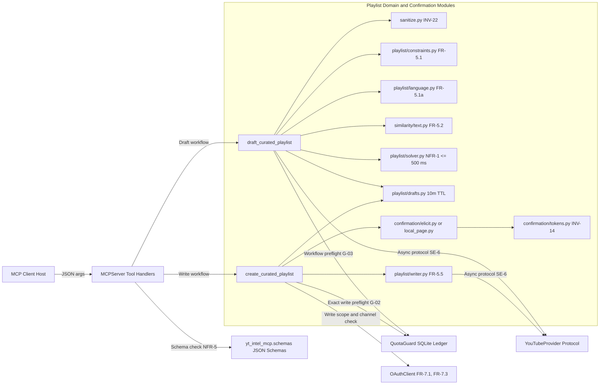
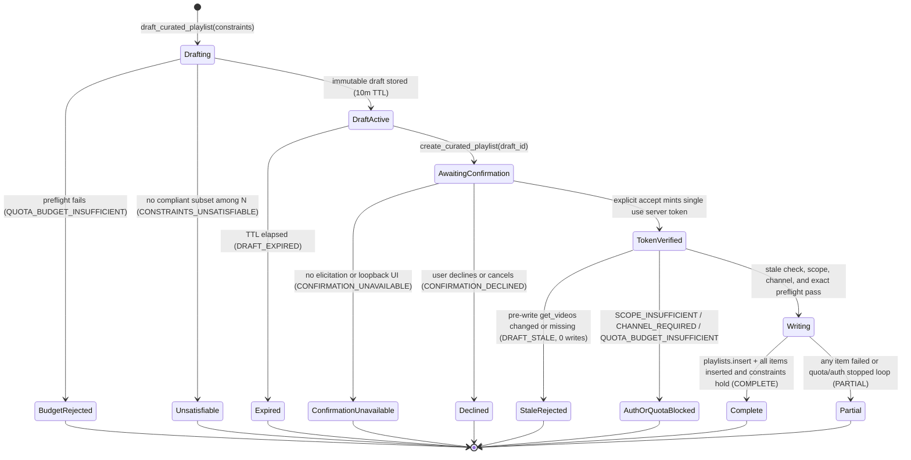
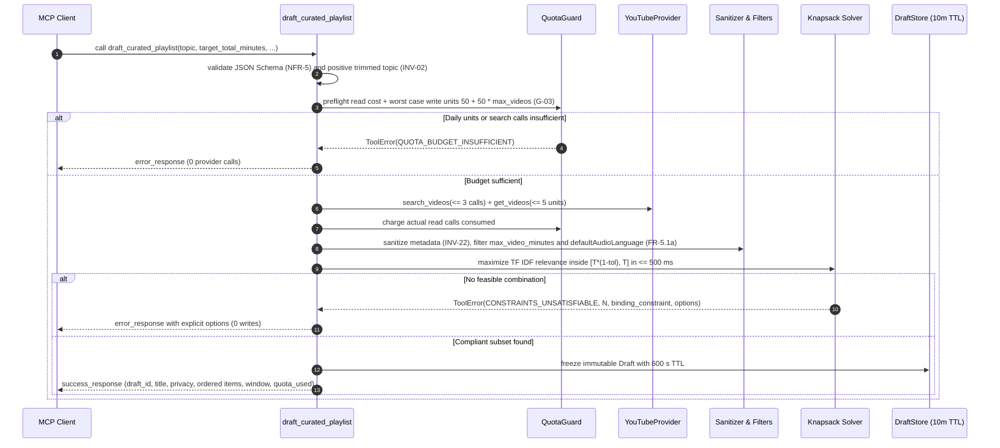

# Playlist Curation, Trusted Confirmation, and Write Architecture (`FR-5`)

- **Task:** `MF-04` (`SE-2`)
- **Owner:** Mohammed Farhan (`@farhan4599`)
- **GitHub Issue:** `#34`
- **GitHub PR:** `#35`
- **Requirements:** `FR-5.1`, `FR-5.1a`, `FR-5.2`, `FR-5.3`, `FR-5.4`, `FR-5.5`, `FR-6.2`, `FR-7.1`, `FR-7.3`, `NFR-1`, `NFR-2`, `NFR-5`, `NFR-6`, `NFR-8`, `NFR-9`, `SE-2`, `SE-6`
- **Related ADRs:**
  - `docs/adr/0002-provider-and-errors.md` (`YouTubeProvider`, `QuotaGuard`, 17 `ErrorCode`s)
  - `docs/adr/0004-trusted-confirmation.md` (trusted confirmation channels, token binding, `G-02` step order)
  - `docs/adr/0005-playlist-selection.md` (constraint model, language filter, solver, `G-03` workflow preflight)
  - `docs/adr/0006-token-storage-and-persistence.md` (`TokenStore` encrypted OAuth credentials)

## Architectural Boundaries

1. **Draft vs Write Separation (`FR-5.3`, `FR-5.4`):** `draft_curated_playlist` performs candidate reads and deterministic solving with zero writes, issuing an immutable 10 minute draft. `create_curated_playlist` accepts `draft_id` ONLY (`additionalProperties: false`).
2. **Untrusted Metadata Defense (`NFR-6`, `INV-22`):** Candidate titles, channels, and descriptions pass through `yt_intel_mcp.sanitize` before entering drafts, confirmation dialogs, or the `127.0.0.1` HTML page.
3. **Out of Band Approval (`INV-13`, `INV-14`):** Approval tokens are minted solely inside server memory after explicit accept via MCP `elicitation` or the one time `127.0.0.1` browser page, bound to `(channel_id, draft_id, ordered_video_ids, title, privacy_status, expires_at_utc)`, and never exposed to the LLM.
4. **Non Retried Ordered Writes (`FR-5.5`, `NFR-8`, `INV-16`, `INV-24`):** `playlists.insert` and `playlistItems.insert` run with `0` automatic retries, never reorder or substitute items, and never edit or delete existing playlists.

## Component Architecture (`SE-2`)



## Immutable Draft Lifecycle State Diagram (`FR-5.3`..`FR-5.5`)



## Sequence Flows (`SE-2`)

### 1. Constrained Draft Creation Flow (`draft_curated_playlist`)



### 2. Trusted Confirmation and Playlist Write Flow (`create_curated_playlist`, `G-02`)

```mermaid
sequenceDiagram
    autonumber
    participant Client as MCP Client
    participant Tool as create_curated_playlist
    participant Drafts as DraftStore
    participant Confirm as Elicitation or 127.0.0.1 Page
    participant Tokens as TokenStore (Server Held)
    participant Guard as QuotaGuard
    participant OAuth as OAuthClient
    participant Prov as YouTubeProvider

    Client->>Tool: call create_curated_playlist(draft_id)
    Tool->>Drafts: fetch immutable draft and verify unexpired
    alt Unknown or expired draft
        Drafts-->>Tool: ToolError(INVALID_ARGUMENT or DRAFT_EXPIRED)
        Tool-->>Client: error_response (0 calls)
    else Active draft + local session identity resolved
        Tool->>Confirm: present sanitized account, title, privacy, ordered videos, total, expiry
        alt Neither channel available
            Confirm-->>Tool: ToolError(CONFIRMATION_UNAVAILABLE)
            Tool-->>Client: error_response (0 writes)
        else User declines or cancels
            Confirm-->>Tool: ToolError(CONFIRMATION_DECLINED)
            Tool-->>Client: error_response (0 writes)
        else Explicit user accept
            Confirm->>Tokens: mint single use token bound to (channel_id, draft_id, videos, title, privacy, expiry)
            Tool->>Tokens: verify and consume token (INV-14)
            Tool->>Guard: preflight combined stale check + exact write units (1 + 50 + 50 * N)
            Tool->>Prov: fresh get_videos(ordered_video_ids) stale check
            Tool->>Guard: charge stale check units
            alt Any video unavailable or constraint changed
                Tool-->>Client: ToolError(DRAFT_STALE) (0 writes)
            else Approved videos still valid
                Tool->>OAuth: ensure_write_scope("youtube.force-ssl") (FR-7.1)
                Tool->>OAuth: verify active channel via get_my_channel() & match token channel_id (FR-7.3)
                Tool->>Guard: exact write preflight (50 + 50 * N units)
                Tool->>Prov: insert_playlist(title, privacy) (0 retries, charge 50 u)
                loop For each approved video in exact order (0 retries)
                    Tool->>Prov: insert_playlist_item(playlist_id, video_id, position) (charge 50 u)
                    alt Item error (e.g. VIDEO_UNAVAILABLE)
                        Note over Tool: Record failed item + reason; continue remaining videos
                    else Quota or auth error
                        Note over Tool: Record failed item; stop loop; mark rest not_attempted
                    end
                end
                Tool-->>Client: success_response COMPLETE or PARTIAL report with playlist_url
            end
        end
    end
```

## Module Responsibilities Summary

| Module | Owner Task | Primary Responsibility | Strict Boundary Invariants |
|---|---|---|---|
| `src/yt_intel_mcp/schemas/` | `MF-04` | Strict JSON Schemas (`draft_curated_playlist`, `create_curated_playlist`) | `NFR-5`, `INV-13`, `draft_id` only |
| `src/yt_intel_mcp/sanitize.py` | `MF-07` | NFKC normalization, invisible/bidi strip, URL removal, HTML escaping | `NFR-6`, `INV-22` |
| `src/yt_intel_mcp/playlist/constraints.py` | `MF-08` | Strict duration window `[T*(1-tol), T]` and inclusive `max_video_minutes` | `FR-5.1`, `INV-09` |
| `src/yt_intel_mcp/playlist/language.py` | `MF-09` | BCP 47 primary subtag matching solely on `defaultAudioLanguage` | `FR-5.1a`, `INV-10` |
| `src/yt_intel_mcp/playlist/solver.py` | `MF-10` | TF IDF relevance maximization (`<= 500 ms` / 200 items) and rich errors | `FR-5.2`, `NFR-1`, `INV-11` |
| `src/yt_intel_mcp/playlist/drafts.py` | `MF-11` | Immutable server drafts with 10 minute expiry and draft tool handler | `FR-5.3`, `INV-12`, `G-03` |
| `src/yt_intel_mcp/confirmation/tokens.py` | `MF-12` | Single use server held confirmation tokens bound to exact draft state | `FR-5.4`, `INV-14` |
| `src/yt_intel_mcp/confirmation/elicit.py` | `MF-13` | MCP `elicitation/create` confirmation channel | `FR-5.4`, `INV-13` |
| `src/yt_intel_mcp/confirmation/local_page.py` | `MF-13` | Strict `127.0.0.1` one time HTML/POST confirmation page | `FR-5.4`, `NFR-6`, `INV-13`, `INV-22` |
| `src/yt_intel_mcp/playlist/writer.py` | `MF-14` | `G-02` step pipeline, stale recheck, non retried writes, `PARTIAL` report | `FR-5.5`, `NFR-8`, `INV-15..17` |
